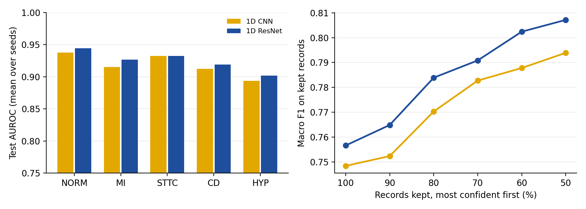

# PTB-XL ECG Superclass Benchmark v0.2.0

**1D CNN and 1D ResNet baselines for multi-label ECG classification on PTB-XL, with seed variation, patient-level intervals and selective prediction.**

The models predict the five PTB-XL diagnostic superclasses: `NORM`, `MI`, `STTC`, `CD` and `HYP`.

> **Research use only. Not a medical device.** Outputs are model scores against dataset labels. They are not diagnoses, triage or treatment advice and must not be used for patient care.

## Research questions

1. Does a compact 1D residual network beat a 1D CNN of similar size on the official PTB-XL test fold, once seed-to-seed variation and patient-level uncertainty are taken into account?
2. When low-confidence records are set aside, how much does macro F1 improve on the records that are kept, and does the gain differ between the two models?

## Dataset

- PTB-XL 1.0.3 (PhysioNet): 21,799 ten-second 12-lead ECGs from 18,869 patients. The 2020 paper describes version 1.0.1 (21,837 records from 18,885 patients); version 1.0.3 removed duplicate records and revised some labels.
- Records with no diagnostic superclass are excluded. The 100 Hz signals are used.
- Official stratified folds, split by patient: folds 1–8 train, 9 validation, 10 test. The preparation step checks that no patient appears in two partitions.
- Not redistributed. Licence: CC BY 4.0.

## Method

- Channel-wise normalisation from the training folds only.
- Each model is trained with five seeds (17, 23, 31, 47, 59), AdamW, binary cross-entropy, early stopping on validation loss (patience 5, at most 40 epochs).
- Per-label decision thresholds are chosen on the validation fold and frozen for the test fold.
- Reported: macro AUROC per seed (mean and SD), the seed-ensemble macro AUROC with a 95% patient-level bootstrap interval, the paired ResNet − CNN difference, per-label AUROC and macro F1 when only the most confident 100%, 90%, …, 50% of records are kept.

## Run on Kaggle (recommended)

Import `notebooks/ptbxl_cnn_vs_resnet.ipynb` from this repository into Kaggle, set **GPU** and **Internet on**, and run all cells. The notebook installs the package, gets PTB-XL, trains ten models and writes `reports/` (tables, chart, per-seed metrics and test probabilities).

## Results

Official test fold (fold 10): 2,158 records. Kaggle T4 GPU, five seeds per model. Full outputs: `results/kaggle-2026-11-19/`.

| Model | Macro AUROC, mean ± SD over 5 seeds | Seed-ensemble macro AUROC [95% CI] | Macro F1 at 100% / 80% / 50% coverage |
|---|---|---|---|
| 1D CNN | 0.9184 ± 0.0022 | 0.9227 [0.9148, 0.9305] | 0.748 / 0.770 / 0.794 |
| 1D ResNet | 0.9250 ± 0.0030 | 0.9317 [0.9242, 0.9387] | 0.757 / 0.784 / 0.807 |

ResNet minus CNN (seed ensembles): **+0.0090 [+0.0068, +0.0113]**; ResNet is higher in 4 of 5 paired seeds. Intervals come from 1,000 patient-level bootstrap resamples. Coverage is the share of test records kept, most confident first; ensemble values.

Mean per-label AUROC over seeds:

| Model | NORM | MI | STTC | CD | HYP |
|---|---|---|---|---|---|
| 1D CNN | 0.938 | 0.915 | 0.933 | 0.912 | 0.894 |
| 1D ResNet | 0.945 | 0.927 | 0.933 | 0.919 | 0.902 |

HYP is the hardest label for both models (average precision about 0.66–0.69).



## Run locally

```bash
cd ptbxl-ecg-superclass-benchmark
python3.11 -m venv .venv
source .venv/bin/activate
python -m pip install --upgrade pip
pip install -e ".[dev]"
pytest -q
```

Download PTB-XL (large; allow time and disk space):

```bash
python -m cardionet.cli download --output data/raw
```

Prepare a patient-level split and cached arrays:

```bash
python -m cardionet.cli prepare --data-dir data/raw --output-dir data/processed --sampling-rate 100
```

Train a baseline (CPU):

```bash
python -m cardionet.cli train --config configs/default.yaml --model cnn --epochs 40 --seed 17
```

Train ResNet:

```bash
python -m cardionet.cli train --config configs/default.yaml --model resnet --epochs 40 --seed 17
```

Evaluate a checkpoint:

```bash
python -m cardionet.cli evaluate --config configs/default.yaml --checkpoint checkpoints/resnet_s17_best.pt
python -m cardionet.cli analyse --checkpoint-dir checkpoints --output reports
```

All commands run on CPU or GPU; a GPU is used automatically when available. Training time depends on CPU, disk, and PyTorch build. Start with a smaller epoch count to validate the pipeline.

## Methodology and safeguards

- Patient-level official folds: folds 1–8 train, 9 validation, 10 test. No patient should cross partitions; the preparation step checks this.
- Multi-label targets are the five superclass indicators; no forced single-class argmax.
- Training-only normalization statistics are applied to validation/test.
- Validation threshold selection is performed per label, then frozen for test evaluation.
- Reports include macro/micro F1, macro AUROC (where defined), per-label AUROC and average precision, and confusion-independent multilabel metrics.
- Selective prediction ranks records by mean label confidence (the mean of max(p, 1 − p) over the five labels). It is a research analysis, not a clinical safety guarantee.

## Repository layout

```text
src/cardionet/       data, models, training, evaluation, CLI
configs/             experiment configuration
notebooks/           Kaggle notebook for the full experiment
tests/               unit tests
docs/                protocol, model card, references
reports/             generated metrics (not committed by default)
```

## Reproducibility

Record Python/PyTorch versions, random seed, config, git commit, dataset version and dataset checksum in each run's `run_metadata.json`. The default seed is 17.

## Citation

If you use this software, cite the repository and the PTB-XL dataset paper listed in `docs/REFERENCES.md`.
